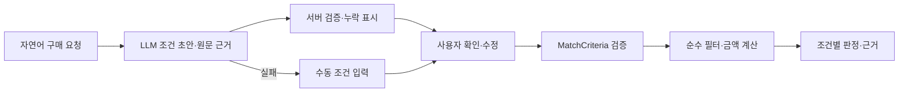

# LLM 연동 계획: API 검증 후 로컬 모델 비교

작성·공식 자료 확인: 2026-10-22. 사용자가 선택한 순서는 **API로 먼저 검증한 뒤 로컬 모델을 비교**하는 것이다. 이 문서는 후속 구현 계획이며, 이번 변경에서 LLM 호출·과금·모델 다운로드·GPU 서버 설치를 수행하지 않았다.

## 첫 적용 범위

LLM은 자연어에서 구매 조건의 **초안과 원문 근거**를 추출한다. 사용자가 초안을 확인·수정한 뒤 [구매 조건 필터](../../recommend-service/app/service/matching.py)가 판정한다. 금액·충족 여부·QCD 점수는 서버 코드가 계산한다.

필수값이 없는 문장도 추출할 수 있도록 후속 `PurchaseDraft`는 필드를 nullable로 둔다. 현재 `MatchCriteria`의 필수값을 LLM이 채우게 하지 않는다. 예를 들어 “주철관 3본, 총 5천 원 이내”의 규격·납기·인증은 미지정이며 “총”은 `total`로 보존한다. 운임·세금을 추정하지 않는다.

| 초안 항목 | 서버 처리 |
| --- | --- |
| `draft` | 품명·규격·수량·단위·예산·예산 범위·납기·인증. 언급하지 않은 값은 null, 인증 미지정도 초안에서는 null |
| `evidence` | 추출한 필드별 원문 인용. 실제 입력의 부분 문자열인지 검증하고 값과 함께 확인 화면에 전달 |
| `ambiguities` | “약 30일”, 복수 규격·대체품, 단위가 없는 수량, 운임 포함 여부 등 해결되지 않은 조건 |
| `unsupportedConditions` | 지역·MAS·우수제품 등 현재 필터가 지원하지 않는 조건. 보존해 안내하며 조용히 버리고 매칭하지 않음 |
| `missingFields` | 서버가 계산한 필수 누락 목록. LLM의 자기 확신 점수로 통과시키지 않음 |

“이번 달 말” 같은 상대 날짜는 서버가 `Asia/Seoul` 기준일을 전달하고 코드로 확정한다. 예산 문자열·단위·정수·날짜 일관성은 확인 후 현재 `MatchCriteria`로 다시 검증한다. 인용문 존재만으로 추출값의 의미가 검증되는 것은 아니므로 고정 사례 평가와 사용자 확인을 유지한다.

## 추천 모델

아래 순서는 이 프로젝트의 짧은 한국어 구매 조건 추출에 대한 **평가 제안**이다. 한국어 조달 정확도나 실제 지연을 측정한 순위가 아니다. API 계정별 모델 접근 가능 여부는 구현 전에 확인한다.

| 용도 | 후보 | 선택 이유와 비교 방식 |
| --- | --- | --- |
| 첫 API 기준 모델 | `gpt-6-luna` | 공식 문서가 짧고 반복되는 작업에 효율적인 모델로 안내하고 Structured Outputs를 지원한다. 조건 JSON 추출의 비용·정확도 기준을 먼저 측정 |
| API 품질 비교 | `gpt-6.1-sol` | 같은 평가셋으로 복합 조건·모호한 문장의 추출 차이를 비교. 자동 재호출·상시 고비용 fallback으로 붙이지 않음 |
| 첫 로컬 소형 모델 | `Qwen/Qwen3.5-4B`의 호환되는 양자화 배포 | 작은 모델에서 누락·부정·단위·한국어 규격을 얼마나 보존하는지 비교 |
| 로컬 품질 비교 | `Qwen/Qwen3.5-9B`의 호환되는 양자화 배포 | 4B의 오류가 줄어드는지 메모리·지연 증가와 함께 평가 |

공식 근거: [GPT-6 Luna](https://developers.openai.com/api/docs/models/gpt-6-luna), [GPT-6.1 Sol](https://developers.openai.com/api/docs/models/gpt-6.1-sol), [Qwen3.5-4B 모델 카드](https://huggingface.co/Qwen/Qwen3.5-4B), [Qwen3.5-9B 모델 카드](https://huggingface.co/Qwen/Qwen3.5-9B). Qwen 두 모델 카드는 Apache-2.0으로 표시되어 있다. 실제로 사용하는 양자화 파일의 출처·라이선스·모델 리비전도 따로 기록한다.

2026-10-22 공식 모델 페이지의 Standard 텍스트 100만 토큰당 가격은 Luna 입력 $0.10·출력 $0.50, Sol 입력 $2·출력 $10이다. 예를 들어 Luna에서 과금 입력 1,000·출력 300토큰이면 단순 계산은 $0.00025다. 실제 비용은 reasoning·캐시·처리 등급과 실제 usage에 따라 달라지므로 이 예시를 실측 비용으로 쓰지 않는다. 평가 시점의 공식 가격과 실제 usage로 요청당 비용을 다시 계산한다.

## vLLM과 sLLM의 역할

sLLM은 작은 언어 모델을 가리키는 말이며, vLLM은 모델을 실행하고 API로 제공하는 추론 서버다. **작은 Qwen 모델을 vLLM으로 제공**할 수 있다. 외부 API 모델의 가중치를 받아 vLLM으로 실행하는 구조는 아니다.

현재 개발 컴퓨터는 `sysctl`로 확인한 **Apple M5, 메모리 32GiB**다. 첫 로컬 비교는 Apple Silicon용 [MLX-LM](https://github.com/ml-explore/mlx-lm) 또는 [vLLM-Metal](https://docs.vllm.ai/en/latest/getting_started/installation/gpu/)의 해당 모델 지원을 확인한 뒤 진행한다. vLLM 공식 설치 문서는 Apple Silicon용 별도 Metal 패키지를 안내한다. Linux CUDA 설치 명령을 현재 Mac에 그대로 적용하지 않는다.

모델 아키텍처·양자화 형식·채팅 템플릿·JSON 제약 출력의 지원을 실제 버전에서 확인한다. Qwen3.5는 멀티모달 모델이므로 모델 카드의 일반 예제만 보고 MLX-LM의 텍스트 경로와 호환된다고 가정하지 않는다. 호환되는 텍스트 실행 경로를 확인하기 전에는 특정 로컬 실행 명령을 완료 절차로 고정하지 않는다.

첫 실험 설정은 컨텍스트 8,192토큰·동시 요청 1개를 제안한다. 4B/9B의 4bit 가중치만 단순 계산하면 약 2GB/4.5GB지만 양자화 메타데이터·KV 캐시·활성값·런타임·기존 Docker 서비스 메모리는 별도다. 이 숫자로 총 메모리 적합성이나 속도를 보장하지 않는다. 동일한 서비스 기동 상태에서 사용 메모리와 지연을 측정한다.

동시 요청·지속 운영·외부 GPU 서버의 필요가 확인되면 Linux GPU의 vLLM을 검토한다. 현재 vLLM은 [JSON Schema 기반 구조화 출력](https://docs.vllm.ai/en/latest/features/structured_outputs/)을 제공하지만, OpenAI 호환 API가 모든 옵션의 호환을 의미하지는 않는다. 서버의 버전·모델·백엔드 조합으로 같은 초안 계약을 검증한다.

## API 구현 순서와 호출 정책

| 단계 | 변경과 완료 기준 |
| --- | --- |
| 1. 매칭 API·화면 연결 | 백로그 P0-2·P0-3b·P0-4·P0-5. 실제 JWT 신원·역할, gateway POST, Decimal 보존, 장애 503과 후보 0개 구분, 수동 입력 연결 |
| 2. 추출 평가셋 | 가상 한국어 요청 50개와 필드별 정답·원문 근거를 만든다. 30개 개발·20개 보류 평가로 고정하고 프롬프트를 바꿀 때마다 재검증 |
| 3. API 추출 | 기존 `recommend-service`에 `POST /api/recommend/parse`와 작은 호출 함수를 추가. 기존 `httpx`와 Pydantic 사용, 새 서비스·LangChain·벡터 DB 없이 시작 |
| 4. 확인 화면 | 자연어 → 초안·누락·미지원 조건 확인 → 수정 → match. LLM 오류·키 미설정이면 수동 입력 가능 |
| 5. 로컬 비교 | 동일 평가셋·초안 계약으로 Qwen 4B·9B 측정. 모델·양자화·엔진 버전을 기록하고 API와 품질·지연·운영 비용 비교 |
| 6. 설명 | 필터의 검사 코드·실제 값만 문장으로 설명. 숫자·인증·판정을 변경한 출력은 폐기하고 규칙 문구 사용 |

API 첫 호출은 Responses API의 `text.format`에 JSON Schema와 `strict: true`를 지정하는 방식을 사용한다. 모든 필드를 스키마에 선언하고 미지정 값은 nullable로 표현하며 `additionalProperties: false`를 둔다. 구조화 출력은 형태를 제한하므로 값의 정확성·거절·불완전 응답·시간 초과는 별도 처리한다. [공식 Structured Outputs 문서](https://developers.openai.com/api/docs/guides/structured-outputs).

후속 구현의 초기 한도는 입력 2,000자·전체 호출 10초·Luna `reasoning.effort=none`·최대 출력 1,200토큰·자동 재시도 0회다. 이 수치는 실측 전의 제안이며, 출력이 잘리면 불완전 응답으로 처리한다. Sol 비교는 지원되는 `low` 이상의 reasoning 설정을 사용하고 예산을 별도로 측정한다. 엔진에 따라 옵션·출력 한도를 달리 적용하되 서버 검증 계약은 유지한다.

키와 모델 설정은 서버 환경변수에만 둔다. 브라우저 `VITE_*`나 Git에 API 키를 넣지 않는다. 키가 없으면 서버 전체를 기동 실패시키지 않고 parse 기능의 사용 불가 상태와 수동 입력 경로를 제공한다. 인증 사용자별 호출 제한을 두고 입력·카탈로그 문장을 명령으로 실행하지 않으며 도구 호출·자동 발주 권한은 제공하지 않는다.

원문 요청·인증 토큰·키는 기본 로그에 남기지 않는다. 모델명·프롬프트 버전·성공/실패 코드·지연·토큰 사용량만 기록한다. 외부 전송은 사용자가 입력한 구매 요청의 필요한 범위로 제한하고 개인 연락처·고객 원본 문서는 평가 자료로 사용하지 않는다. `store: false`를 지정하더라도 제공자의 모든 보관 정책을 무보관으로 단정하지 않는다.

## 평가와 채택 기준

| 측정 | 초기 기준 |
| --- | --- |
| 형식·서버 검증 | 유효한 초안 구조, 잘못된 정수·금액·추가 필드 거부, 거절·시간 초과·잘린 출력 처리 |
| 필드 정확도 | 품명·전체 규격·수량·단위·예산 범위·날짜·인증의 정확 일치를 필드별/요청 전체로 계산 |
| 미확인 처리 | 미언급 값을 생성하거나 `KSQ`를 `KS`로 바꾸거나 총예산을 소계로 바꾸는 사례 0건을 목표로 검토 |
| 근거 | 인용의 원문 일치와 값에 대한 의미상 지지를 함께 검토. 미지원 조건의 유실도 오류로 집계 |
| 지연·비용 | API P50/P95·실제 usage 비용, 로컬 콜드 시작·웜 지연·최대 메모리. 날짜·버전·사례 수 함께 기록 |
| 업무 회귀 | 현재 순수 필터 테스트 통과, LLM 실패 시 수동 입력 가능, 서버 금액·판정·주문을 LLM이 변경하지 못함 |

평가에는 전체 규격의 일부만 같은 문장, 예산 한계, “인증 필요 없음”, 인증 누락, 납기 범위, 상대 날짜, 모순된 기한, 지역·운임 조건, 지시문이 섞인 입력을 포함한다. 소수 평가셋의 0건은 운영 오류율 0%를 뜻하지 않는다. 처음부터 파인튜닝하지 않고 반복 오류가 확인된 뒤 데이터·라이선스·학습 비용을 검토한다.

현재 완료된 것은 순수 필터와 테스트·CI 연결이다. API 호출·한국어 추출 성능·로컬 모델 호환성·실제 지연·비용은 후속 검증 대상이다.
